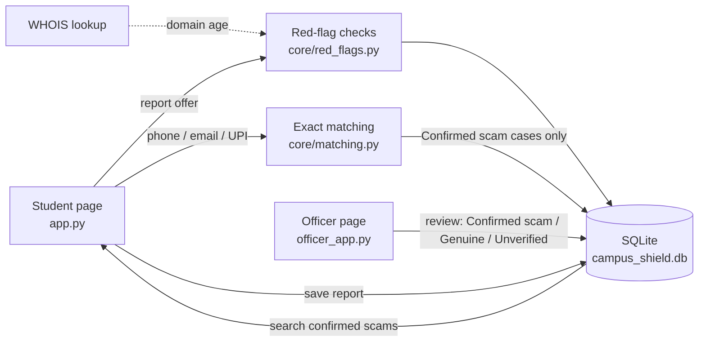
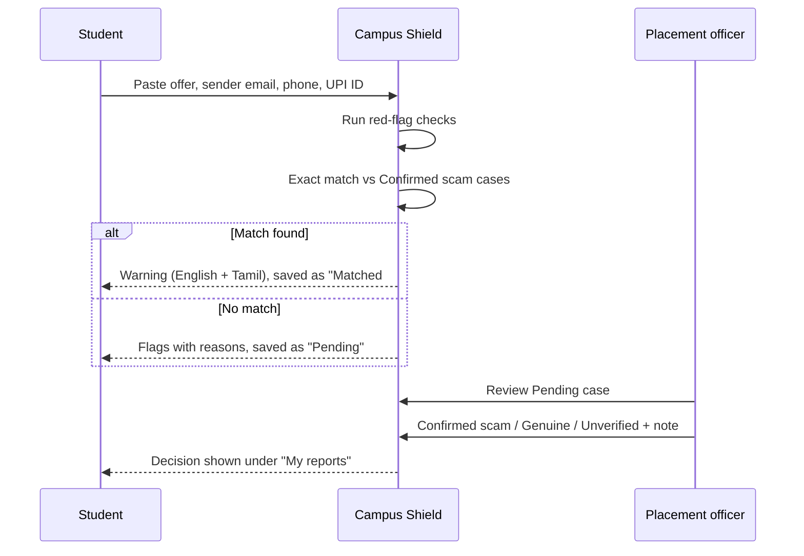

# Campus Shield – Technical Design

Team KALIBRE (HSC|TN|01014) · Theme: Digital Safety & Cyber Fraud Awareness

## 1. Problem
Fake internship and job offers reach students through WhatsApp, email and Telegram. They ask for a "registration fee" or "security deposit". When one student is cheated, the next student gets the same offer from the same phone number or UPI ID, because nothing connects their reports.

## 2. What Campus Shield does
The college placement cell runs Campus Shield. A student reports a suspicious offer. The app shows warning signs straight away. A placement officer reviews it and decides. Once the officer confirms a case as a scam, every later report with the same phone, email or UPI ID gets an automatic warning in English and Tamil.

## 3. Architecture

| Part | File | Job |
|---|---|---|
| Student page | `app.py` | Report an offer, see flags and match warnings, track own reports, search confirmed scams |
| Officer page | `officer_app.py` | Review the queue, set a decision with a note, see counts |
| Red flags | `core/red_flags.py` | Rule-based cautions, each with a plain reason |
| Matching | `core/matching.py` | Exact match against **Confirmed scam** cases only |
| Storage | `core/db.py` | SQLite file shared by both pages |
| Sample data | `data/sample_cases.csv`, `seed.py` | 17 simulated cases, plus `data/demo_reports.csv` with 4 repeat-scam reports for the live demo |

## 4. Flow, step by step

## 5. Data model (table `cases`)
`case_id, created_at, reporter, company_claimed, offer_text, sender_email, phone, upi_id, flags, status, officer_note, matched_case_id`

Status values: `Pending`, `Confirmed scam`, `Genuine`, `Unverified`, `Matched #N`.

## 6. Red-flag rules
| Flag | Fires when | Does not fire on |
|---|---|---|
| Fee demand | A fee phrase ("registration fee", "security deposit"...), "pay/send/transfer Rs N", or a UPI ID together with an amount | A stipend or salary amount |
| Free-mail sender | A company offer comes from Gmail, Yahoo, Outlook, Rediffmail or Hotmail | Offers with no company named |
| New domain | The sender's email domain is under 180 days old (WHOIS) | Free mail; any WHOIS failure is skipped silently |
| Urgency words | "within 24 hours", "immediately", "limited seats", "within N minutes"... | — |

Flags are cautions, not verdicts. Only the officer marks a case as a scam.

## 7. Matching
Phone numbers are reduced to their last 10 digits. Email and UPI IDs are trimmed and lower-cased. A match is exact and only against cases the officer has confirmed, so an unreviewed report can never trigger a warning on someone else.

## 8. Privacy and limits
- All sample data is simulated. No real student or company data is used.
- Students can only search Confirmed scam cases, never Pending ones.
- Exact matching misses a scammer who changes number and UPI ID; flags still help there.
- It is a single-college prototype on SQLite. Logins and multi-college sharing are future work.

## 9. Tests
`py -m pytest` runs 13 tests: fee rule, stipend safety, zero-fee offers, deposits, free mail, urgency, confirmed-only matching, case-insensitive UPI match, confirmed-only search, seeding, no fee flags on genuine samples, and every demo report matching a confirmed case.

## 10. Use of AI tools
See `ai_log.md`. AI assistants were used for research, drafting documents and reviewing code; every change was read, run and tested by the team.
